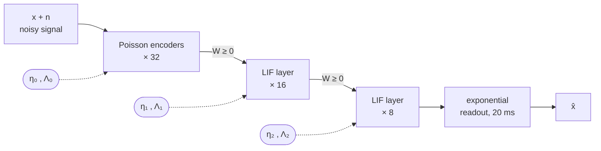
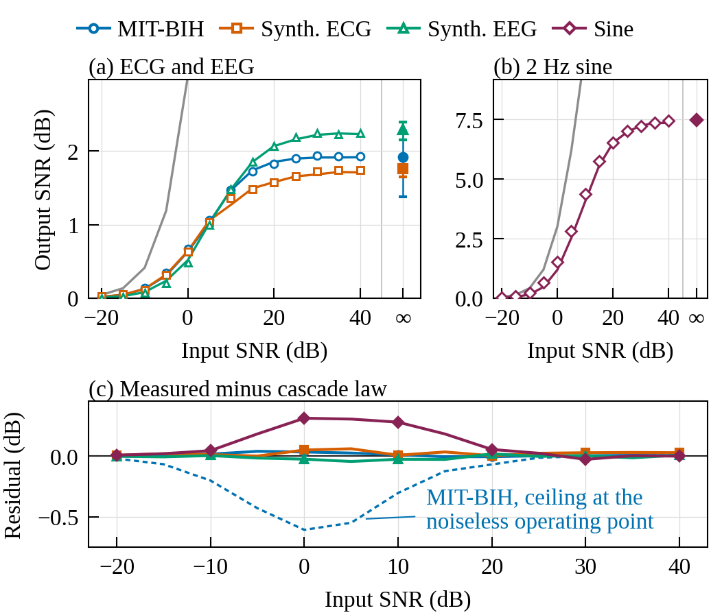
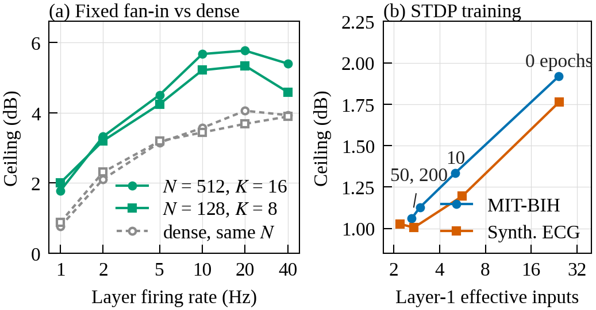

<div align="center">

# NeuroFlux

**How faithfully can a spiking neural network reproduce a biosignal, and what sets the limit?**

[](paper/icee2026/)
[](https://github.com/ahadullabaig/NeuroFlux/actions/workflows/ci.yml)
[](.python-version)
[](pyproject.toml)
[](LICENSE)

[Paper](paper/icee2026/) · [Results](#results) · [Quickstart](#quickstart) · [Reproduce](#reproducing-the-paper) · [Research log](#research-log) · [Cite](#citation)

</div>

> [!NOTE]
> **Accepted at IEEE ICEE 2026**, the 8th IEEE International Conference on Emerging Electronics, Bengaluru, India (track: *Memory Technologies & Neuromorphic Computing*).
>
> A. U. Baig, D. Gera and C. G, "Feed-Forward Spiking Networks Obey a Friis-Type Cascade Law: Fidelity Ceilings and a Fan-in Design Rule for Biosignal Processing." The DOI and IEEE Xplore link will be added when the paper is published.

NeuroFlux is a spiking neural network (SNN) simulator for biomedical signals, together with the complete experimental record behind our ICEE 2026 paper. The question it answers is one that SNN studies rarely quantify. When a network of leaky integrate-and-fire (LIF) neurons turns a biosignal into spikes and reads it back out, how close to the original can the output be?

We measured this on 16 records from the MIT-BIH Arrhythmia Database and on three synthetic signals (ECG, EEG and a sine), across more than 65,000 simulations. Feed-forward spiking networks turn out to have a **fidelity ceiling**, and it can be calculated: each spiking stage adds noise the way an amplifier stage does in a radio receiver.

## Key findings

1. **There is a ceiling.** Above 10 dB input SNR, output SNR rises by less than 0.1 dB for each dB of input. This holds on real and synthetic ECG, EEG and a sine, under three spike codes. On MIT-BIH the reference network's output levels off at 1.92 dB, however clean the input is.
2. **A cascade law of Friis's form predicts it.** Inverse signal-to-noise ratios add from stage to stage. One noiseless run gives the ceiling at an operating point, and from it the law predicts the output on real ECG to **0.04 dB RMS over a 60 dB input range, with no fitted parameters**.
3. **Shared noise sets the ceiling, and fan-in can raise it.** Noise that neurons have in common caps what averaging can recover, so a wider network does not help. STDP learning lowers the ceiling: it cuts each first-layer neuron's effective number of inputs from 24 to about 3. Giving every neuron a **fixed fan-in of 16** raises the ceiling by **1.85 dB, to 5.77 dB, with 32× fewer synapses**.

> [!IMPORTANT]
> **What this is not.** NeuroFlux is not an ECG denoiser. A standard ECG filter recovers heartbeats better than any network configuration we tested. Run through NeuroKit2's standard cleaning, the noisy input significantly beats the best network condition in 16 of 18 input-level × QRS-detector combinations and never loses. The contribution is a set of **limits and design rules for feed-forward spiking signal chains**.

## The model



A scalar signal sampled at 250 Hz is copied to 32 Poisson encoders. Two all-to-all LIF layers follow, and the output is the mean of the output neurons' exponentially filtered spike trains. Every stage is rate-calibrated to fire at 40 Hz. Stage $k$ adds its own spike-sampling noise $\eta_k$ with intrinsic S/N $\Lambda_k$. Because the gain of a stage scales the signal and the noise it inherits equally, inverse S/N ratios add:

```math
\frac{1}{R_\mathrm{out}} \;=\; \frac{1}{R_\mathrm{in}} \;+\; \sum_k \frac{1}{\Lambda_k},
\qquad
C \;=\; \left(\sum_k \frac{1}{\Lambda_k}\right)^{-1}
```

This is Friis's formula for a cascade of noisy amplifiers. As $R_\mathrm{in} \to \infty$ the output tends to $C$, the ceiling, which depends on the network alone. Every added stage contributes a positive term, so adding depth can only lower the ceiling. Improving a stage whose term is already small barely changes the total.

## Results

<p align="center">
  
</p>
<p align="center"><sub><b>Paper Fig. 2.</b> (a, b) Output SNR saturates on all four signals. Lines are the cascade law, with the ceiling measured at each input's operating point. (c) Measured output minus the law's prediction. The dashed line uses the ordinary noiseless ceiling instead.</sub></p>

**What moves the MIT-BIH ceiling** (median over 16 records at noiseless input; paired change with BCa 95% CI):

| | Manipulation | Ceiling (dB) | Change (dB) [95% CI] |
|---|---|---|---|
| **Does not raise it** | Output width, 8 → 64 | 1.92 → 1.99 | **+0.08** [+0.06, +0.09] ≡ |
| | Readout τ, 20 → 40 ms (best) | 1.92 → 1.98 | +0.21 [−0.06, +0.26] ≡ |
| | Time-to-first-spike code | 2.86 → 2.28 | −0.76 [−1.13, +0.24] |
| **Lowers it** | STDP, 10 epochs | 1.92 → 1.34 | **−0.49** [−0.60, −0.39] |
| | STDP, 200 epochs | 1.92 → 1.06 | **−0.64** [−0.75, −0.56] |
| | Depth, 3 → 4 layers | 1.92 → 1.57 | **−0.36** [−0.40, −0.30] ≡ |
| | Delta code | 2.86 → 0.61 | **−1.63** [−2.25, −1.24] |
| **Raises it** | Depth, 3 → 2 layers | 1.92 → 2.75 | **+0.91** [+0.79, +1.09] |
| | Output rate, 40 → 5 Hz | 1.99 → 2.71 | **+0.81** [+0.17, +1.48] |
| | Fan-in, all → 16 | 4.06 → 5.77 | **+1.85** [+1.38, +2.26] |

<sub>Bold: significant (Wilcoxon signed-rank, Holm-corrected within each family). ≡: equivalent within ±0.5 dB (two one-sided tests). The reference network differs between rows. Most rows use the untrained `[32,16,8]` network. The code rows are delay-compensated, the rate row uses 64 output neurons, and the fan-in row compares against a dense one-layer `[512,512]` network. Full definitions are under Table I in the paper.</sub>

<p align="center">
  
</p>
<p align="center"><sub><b>Paper Fig. 3.</b> (a) A fixed fan-in beats dense connectivity at every firing rate from 1 to 40 Hz. (b) STDP reduces layer-1 effective inputs, and the ceiling falls with them.</sub></p>

### Design rules

These hold for the networks and signals studied here. They are not claims about SNNs in general.

- **Stop improving the sensor early.** Once the sensor's S/N is ten times the ceiling, improving it further adds at most 0.4 dB of output S/N.
- **Use fewer layers.** Removing one of three spiking layers gains 0.91 dB.
- **Use sparse fan-in.** 8–16 inputs per neuron gain up to 1.85 dB, with 16–32× fewer synapses and synaptic events.
- **Match the output rate to the signal.** For ECG, 5 Hz beats 40 Hz. For a sine it does not.
- **Take the encoder range from a low-pass copy of the input.** A 40 Hz low-pass range adds 1.0 dB on the sine. On MIT-BIH at 0 dB input it adds 0.35 dB, short of the 0.5 dB bar we set in advance.

## Quickstart

NeuroFlux uses [uv](https://docs.astral.sh/uv/) workspaces and Python 3.11 or later.

```bash
git clone https://github.com/ahadullabaig/NeuroFlux.git
cd NeuroFlux
make install        # uv sync --all-packages
make test-fast      # the CI test suite
```

Run a network:

```python
import numpy as np
from neuroflux_core import Network, Simulator

# A 2 Hz sine, one sample per 1 ms step, copied to all 32 input channels
t = np.arange(2000) / 1000.0
x = 0.5 + 0.4 * np.sin(2 * np.pi * 2.0 * t)
drive = np.tile(x[:, None], (1, 32))

net = Network.feedforward(layers=[32, 16, 8], seed=0)  # 32 encoders -> 16 LIF -> 8 LIF
sim = Simulator(net, dt=1.0, seed=0)
spikes = sim.run(drive, duration_ms=2000.0, training=False)  # (2000, 8) bool
y = sim.decode(spikes)                                       # (2000,) analog readout
```

Budget a pipeline with the cascade law:

```python
from neuroflux_core.metrics.cascade import cascade_snr_db, ceiling_db

stages = [8.0, 3.0, 1.5]       # intrinsic S/N of each stage in dB, from one noiseless run
ceiling_db(stages)             # -1.36: no input quality gets past this
cascade_snr_db(20.0, stages)   # -1.39: output S/N at 20 dB input S/N
ceiling_db([8.0, 3.0])         # +1.81: dropping the weakest stage is what pays
```

The law holds in S/N terms. Affine-corrected SNR is $1 + S/N$, so convert with `affine_to_excess_db` and `excess_to_affine_db` before and after applying it. The rate-calibrated pipeline used in the paper is `run_spec` in [`scripts/r3_characterisation/r3_common.py`](scripts/r3_characterisation/r3_common.py).

## Reproducing the paper

Every number in the paper traces back to a committed analysis. [`paper/icee2026/README.md`](paper/icee2026/README.md) maps each figure, table and section to its source.

```bash
# Figures 2-3 and Table I, from the committed analyses (seconds)
uv run python scripts/paper_icee2026/figures.py

# Camera-ready decomposition of the ceiling (post hoc; needs the MIT-BIH records cached)
uv run python scripts/paper_icee2026/icee_decomposition.py

# Build the PDF
cd paper/icee2026 && latexmk -pdf -outdir=build main.tex
```

To rerun the simulations from scratch, use the commands in the *Reproduce* block at the top of [`docs/r3_findings.md`](docs/r3_findings.md), [`docs/r4b_findings.md`](docs/r4b_findings.md) and [`docs/r5_findings.md`](docs/r5_findings.md). The R3 grids take about 2.5 hours on 16 cores. Raw grids are committed as `*.csv.gz`, and the analyses read them directly, reproducing every table byte for byte. MIT-BIH records are downloaded from PhysioNet on first use, checked against SHA-256 checksums, and cached in the gitignored `data/` directory.

The statistics were fixed before the main grids ran. The unit of analysis is the record (n = 16), paired comparisons use Wilcoxon signed-rank tests with Holm correction and BCa bootstrap intervals, and an invariance is claimed only when two one-sided tests show equivalence. Every check designed after seeing the data is labelled *post hoc*.

## The library

`neuroflux-core` is a small, typed SNN engine. Its kernels are compiled with Numba.

| Module | Contents |
|---|---|
| `neurons` | Vectorized LIF neurons with refractory clamping, in a Numba `@njit` kernel |
| `synapses` | O(1) trace-based pair STDP |
| `encoders` | Poisson rate, time-to-first-spike and delta (send-on-change) encoders |
| `decoders` | Population (exponential trace) and sliding-window spike-rate readouts |
| `network` | `FeedForwardNetwork`, `Simulator`, per-layer gain and encoder-rate calibration |
| `metrics` | Cascade law, SNR, PRD/PRD1, QRS detection scored against MIT-BIH annotations (EC57, ±150 ms), firing statistics |
| `io` | Pydantic configs (YAML/JSON) and `.npz` checkpoints |

`neuroflux-datasets` adds synthetic ECG, EEG and sine generators with exact input-SNR control, the MIT-BIH data layer (download, verify, resample from 360 to 250 Hz, extract clean segments, split by record), and the `neuroflux-experiment` sweep CLI.

On every push to `main` and every pull request, CI runs `ruff`, strict `mypy` over the whole repository, and a test suite with property-based tests (Hypothesis), SHA-256-pinned snapshot tests of the network dynamics, regression tests on the canonical configurations, and an 85% coverage gate.

## Research log

The paper is the end of a sequence of stages. Each one is written up with its pre-registered question, data, and any corrections to earlier stages.

| Stage | What it established |
|---|---|
| [Phase 3](docs/phase3_findings.md) | On real ECG, NeuroFlux reconstructs at a fixed quality. It is not a denoiser. |
| [R1](docs/r1_findings.md) | The original R-peak metric was saturated. QRS F1 scored against annotations replaces it. |
| [R2](docs/r2_findings.md) | The record is the unit of analysis. Every Phase 3 claim is re-tested at that unit. |
| [M1a](docs/m1a_findings.md) | The ceiling is not an artifact of copying one signal to every input. Independent input channels do not lift it. |
| [M2](docs/m2_findings.md) | Most of the fidelity is lost in the LIF layers, not in the encoder or the readout. |
| [M3](docs/m3_findings.md) | The inverse-SNR cascade law (`metrics/cascade.py`). |
| [M4](docs/m4_findings.md) | Sparse initialisation works by decorrelation, and fan-in sets the optimum. |
| [R3](docs/r3_findings.md) | Characterising the ceiling: flatness, invariances, operating region. |
| [R4b](docs/r4b_findings.md) | STDP lowers the ceiling by collapsing effective fan-in. Fixed fan-in raises it at every rate. |
| [R5](docs/r5_findings.md) | Generality across encoders, readouts and QRS detectors. Delay-compensated ceilings. |
| [H1](docs/h1_findings.md) | *Ongoing:* what fidelity costs in hardware (fan-in, weight precision, device variation). |

Supporting documents: [related work](docs/related_work.md), [paper roadmap](docs/paper_roadmap.md), the original [technical specification](DETAILS.md) and [project plan](PLAN.md).

<details>
<summary><b>How the project got here</b></summary>
<br>

NeuroFlux started as an unsupervised STDP denoiser for powerline flicker in ECG. Direct measurement ended that framing. A conventional notch and band-pass filter beat it on every noise type we tried, and the 0.5–40 Hz band-pass that is standard in ECG preprocessing already removes powerline interference. The network's own numbers were still interesting, though: its output quality was almost the same whatever was wrong with the input. That observation became the ceiling result. The full account is in [`docs/paper_roadmap.md`](docs/paper_roadmap.md).

Earlier versions of this README reported that the untrained network preserved R-peaks perfectly and that STDP damaged them. That came from a saturated metric. The finding was reversed in [R1](docs/r1_findings.md) and [R2](docs/r2_findings.md) and is kept here only as a correction.

</details>

## Repository layout

```
packages/
  core/          neuroflux-core: neurons, synapses, encoders, decoders, network, metrics, io
  datasets/      neuroflux-datasets: synthetic signals, MIT-BIH pipeline, experiment CLI
scripts/         one directory per research stage (r3_characterisation/, r4b_mechanism/, ...)
results/         committed results: raw grids (*.csv.gz), analyses, figures
docs/            findings for each stage, related work, roadmap
paper/icee2026/  the ICEE 2026 manuscript, figures and number-to-source map
configs/         YAML sweep configurations
tests/           unit, property-based, snapshot and regression tests
```

## Citation

If you use NeuroFlux or its results, please cite the paper. GitHub's **Cite this repository** button reads the same entry from [`CITATION.cff`](CITATION.cff).

```bibtex
@inproceedings{baig2026cascade,
  author    = {Baig, Ahad Ulla and Gera, Divisha and G, Charithra},
  title     = {Feed-Forward Spiking Networks Obey a {Friis}-Type Cascade Law:
               Fidelity Ceilings and a Fan-in Design Rule for Biosignal Processing},
  booktitle = {2026 8th IEEE International Conference on Emerging Electronics (ICEE)},
  address   = {Bengaluru, India},
  publisher = {IEEE},
  year      = {2026}
}
```

Work using the MIT-BIH data should also cite the database (Moody and Mark, *IEEE Eng. Med. Biol. Mag.*, 2001) and PhysioNet (Goldberger et al., *Circulation*, 2000).

## License

The code is released under the [MIT License](LICENSE). The manuscripts under `paper/` are not covered by it. The ICEE 2026 paper is © 2026 IEEE and is posted as the accepted version under IEEE's author-posting terms (see [`paper/icee2026/README.md`](paper/icee2026/README.md)). Other drafts there remain © the authors. MIT-BIH records are not redistributed here; they are downloaded from [PhysioNet](https://physionet.org/content/mitdb/) under its terms.

## Authors

**Ahad Ulla Baig**, **Divisha Gera** and **Charithra G**
Department of Artificial Intelligence and Machine Learning, Ramaiah Institute of Technology, Bengaluru, India

Questions and issues are welcome on the [issue tracker](https://github.com/ahadullabaig/NeuroFlux/issues).
